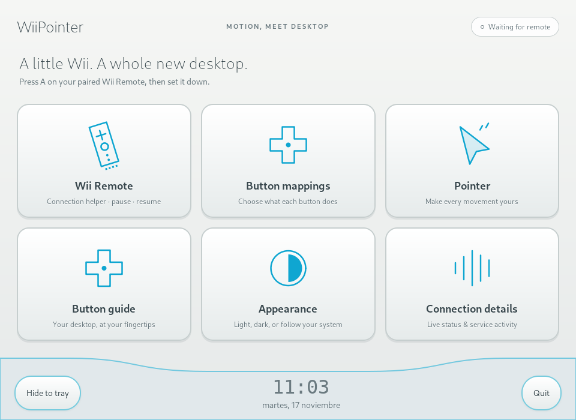
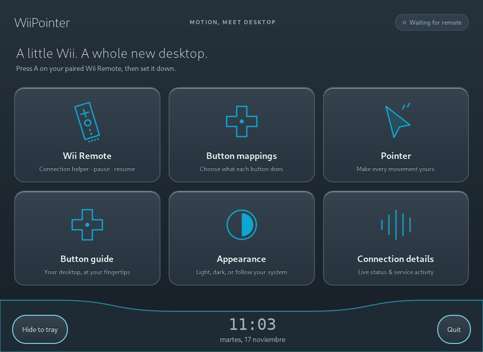

<p align="center"></p>

# WiiPointer

Use a Wii Remote as an air mouse and presentation clicker on Linux. WiiPointer
runs as a desktop app with a GNOME tray menu, editable controls, and a Wii Menu-inspired
interface. It works with GNOME Wayland and needs a MotionPlus sensor, not a sensor bar.

| Wii Light | Midnight Wii |
| --- | --- |
|  |  |

## What it does

- Hold B to move the pointer. Use A to click or drag, and the D-pad to change slides.
- Adjust sensitivity, smoothing, acceleration, deadzone, axis inversion, and roll
  compensation while connected. Changes apply live and keep your calibration.
- Remap buttons to mouse clicks, slide controls, volume, desktop shortcuts, or aiming.
- Use the connection helper to check Bluetooth, scan, select a remote, and reconnect.
- Close the window or choose **Hide to tray** to keep input available. Quit stops
  the backend and releases its virtual input devices.

The backend runs only while the app is open, including when it is in the tray.
Opening another instance brings the existing window back. There is no login autostart.

## Install

WiiPointer currently targets Linux laptops with GNOME, BlueZ, the kernel Wii driver,
and Python 3.10 or later. The installer creates a launcher pointing to your checkout;
keep the checkout in place after installing.

On Debian or Ubuntu:

```sh
sudo apt install python3-gi python3-gi-cairo python3-evdev \
  gir1.2-gtk-3.0 gir1.2-ayatanaappindicator3-0.1 bluez

git clone https://github.com/rh45-one/WiiPointer.git
cd WiiPointer
/usr/bin/python3 install-desktop.py
```

Launch **WiiPointer** from Activities, or run:

```sh
~/.local/bin/wiipointer
```

GNOME needs the [AppIndicator and KStatusNotifierItem Support extension](https://extensions.gnome.org/extension/615/appindicator-support/)
to show tray icons. If no tray host is available, WiiPointer keeps the window open
when you try to hide it.

Input access needs a one-time setup on some systems. Follow the
[hardware and permissions guide](docs/hardware.md) if the remote connects over
Bluetooth but input never becomes ready. Run the app as your normal desktop user,
never with `sudo`.

Upgrading from the old CLI service? The installer stops and disables
`wii-clicker.service` so it cannot compete with the app. Your calibration files
and the source service unit stay in the checkout.

## Connect and calibrate

1. Keep the Wii console off. Open the **Wii Remote** channel for the connection helper.
2. If already paired, press A on the remote. For a new pairing, hold 1 + 2 or press
   the red SYNC button, scan, and finish pairing in GNOME Bluetooth settings.
3. Choose your remote in the helper and click **Use this remote**. You can also
   enter its Bluetooth address directly. Choose **Connect** while the remote is awake.
4. Put it on a stable table for the initial calibration. Wait for **Ready to point**.

The initial measurement needs a still five-second window after a five-second
settling delay. Movement extends the measurement; an unsuccessful initial attempt
retries instead of accepting bad readings.

After the initial calibration, pointer changes, button mappings, pause/resume,
and reconnects reuse the same bias for that app session. To recalibrate, put the
remote down and **hold HOME**. HOME long press is reserved even when you remap its
tap action. A rejected manual measurement keeps the previous bias. Quitting and
reopening the app starts a fresh session; choosing a different remote also needs
its own initial measurement.

The included accelerometer calibration belongs to the development remote. Selecting
a different remote disables roll compensation until you measure its accelerometer.
See the [hardware guide](docs/hardware.md#roll-compensation) before turning it back on.

## Default buttons

| Button | Action |
| --- | --- |
| B, held | Aim; releasing stops pointer movement |
| A | Left click; hold to drag |
| D-pad up / left | Previous slide (Page Up) |
| D-pad down / right | Next slide (Page Down) |
| + / − | Volume up / down |
| HOME, tap | Show desktop (Super+D) |
| HOME, hold | Recalibrate gyro bias |
| 1 | GNOME Activities overview |
| 2 | GNOME quick settings (Super+A) |

Open **Button mappings** to change these. The editor keeps at least one aim action
and one left-click action. HOME tap is editable; HOME long press always recalibrates.
**Button guide** shows your current mappings. GNOME shortcuts depend on your desktop
keybindings.

## Settings and tray controls

**Pointer** contains the motion settings. Defaults are 12 pixels per nominal degree,
25 ms smoothing, a 0.3 degrees/second soft deadzone, gentle acceleration, horizontal
inversion, and roll compensation. Set acceleration to zero for linear response.
GNOME may apply additional pointer acceleration.

Settings save to `~/.config/wiipointer/settings.json`, respecting `XDG_CONFIG_HOME`.
The app sends updates over a private pipe. It does not restart the process, reconnect
the remote, or run a calibration when you change a pointer setting. Changes release
held outputs; press your aim or click button again afterward.

The tray menu has pause/resume, pointer settings, button mappings, the connection
helper, a dark-appearance toggle, and quit. **Appearance** also has a system-following
option. **Connection details** shows live backend messages and input errors.

## Terminal use

Quit the desktop app first. The CLI and desktop backend share a lock to prevent
duplicate input. Existing `wii-clicker` commands still work:

```sh
~/.local/bin/wii-clicker --watch --remote-mac AA:BB:CC:DD:EE:FF
~/.local/bin/wii-clicker --sensitivity 10 --smoothing 0.035
~/.local/bin/wii-clicker --no-roll-compensation --acceleration 0
~/.local/bin/wii-clicker --help
```

CLI options apply at launch; the desktop app provides live settings and mapping edits.
Ctrl+C stops the CLI. Do not enable the legacy service alongside the desktop app.

## Tests

```sh
sudo apt install xvfb xauth

/usr/bin/python3 -m unittest -v test_wii_mouse test_desktop_backend \
  test_live_controls test_bluetooth_helper
GDK_BACKEND=x11 xvfb-run -a /usr/bin/python3 -m unittest -v test_wii_app
node --test prototypes/model.test.mjs
```

The tests cover motion math, calibration timing, live settings, button outputs,
reconnect bias reuse, process cleanup, BlueZ requests, and the native UI. They run
without a controller. Set `WII_SCREENSHOT_DIR` when running UI tests to capture
both appearances. The archived browser prototypes have an additional Playwright
suite described in [prototypes/README.md](prototypes/README.md).

## Project notes

- [Hardware setup, LED access, and troubleshooting](docs/hardware.md)
- [Code layout and development](docs/development.md)
- [Archived UI explorations](prototypes/README.md)

This is an independent project, not a Nintendo product. The interface illustrations
are original. Real-controller checks, including aiming, LEDs, Bluetooth pairing,
and suspend/resume, are still needed before treating a particular laptop/remote
combination as tested.
